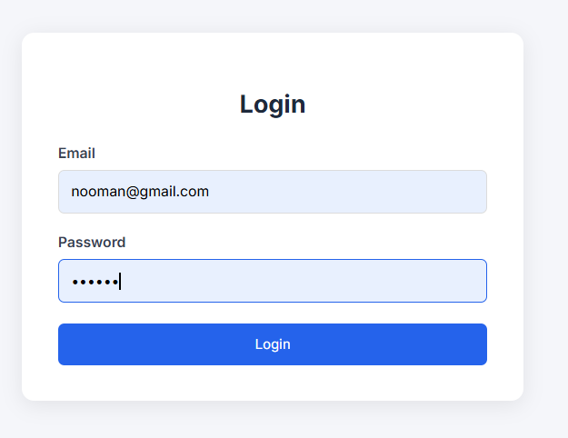
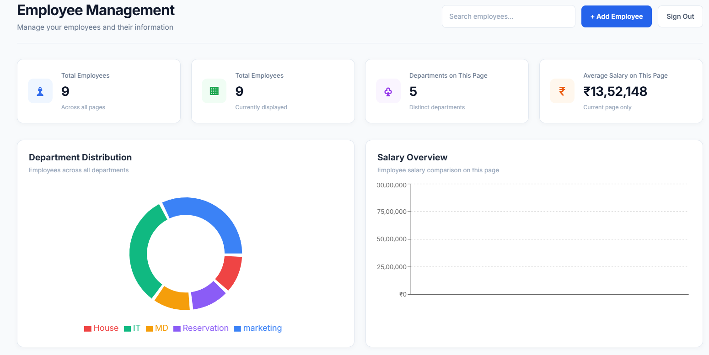
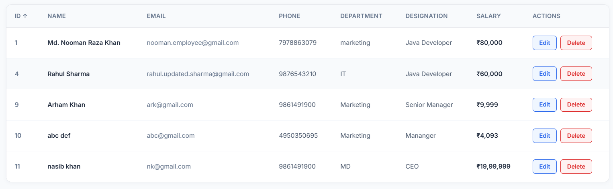

\# Employee Management System


A full-stack Employee Management System developed using \*\*React, TypeScript, Java 21, Spring Boot, Spring Security, JWT Authentication and MySQL\*\*.


The application provides employee record management, secure authentication, role-based authorization and an analytics dashboard to help manage and visualize employee information.


\## Project Overview


The Employee Management System is designed to simplify employee record management through a centralized web application.


It follows a frontend-backend architecture, where the React frontend communicates with RESTful APIs developed using Spring Boot.


\## Features


\### 1. Authentication and Authorization

\- User registration and login.

\- JWT-based authentication.

\- Password encryption using BCrypt.

\- Role-based access control (ADMIN and USER).

\- Protected REST API endpoints.


\### 2. Employee Management

\- Create new employee records.

\- View employee information.

\- Update existing employee details.

\- Delete employee records.

\- Search employees.

\- Pagination and sorting.

\- Input validation and custom exception handling.


\### 3. Analytics Dashboard

\- Total employee count.

\- Average salary overview.

\- Department-wise employee distribution.

\- Employee salary comparison.

\- Interactive charts using Recharts.


\### 4. Frontend

\- Responsive React and TypeScript interface.

\- Dashboard with analytics cards.

\- Employee management interface.

\- API integration using Axios.

\- Role-based UI access.

\- Lazy loading for analytics components.


\## Technology Stack


| Category | Technologies |

|---|---|

| Frontend | React, TypeScript, Vite |

| Backend | Java 21, Spring Boot |

| Security | Spring Security, JWT, BCrypt |

| Database | MySQL 8 |

| ORM | Spring Data JPA, Hibernate |

| API | RESTful APIs, Axios |

| Charts | Recharts |

| Build Tools | Maven, npm |

| Testing | JUnit, Mockito, Vitest |

| Version Control | Git, GitHub |


\## Project Architecture


```text

&#x20;                React Frontend

&#x20;               (React + TypeScript)

&#x20;                      |

&#x20;                      | HTTP / REST API

&#x20;                      |

&#x20;                      v

&#x20;              Spring Boot Backend

&#x20;                      |

&#x20;             Spring Security + JWT

&#x20;                      |

&#x20;                      v

&#x20;                Service Layer

&#x20;                      |

&#x20;                      v

&#x20;               Repository Layer

&#x20;                      |

&#x20;                      v

&#x20;                  MySQL DB

```


\## Project Structure


```text

employee-management-system/

│

├── employee-management-system/

│   ├── src/

│   │   ├── main/

│   │   │   ├── java/

│   │   │   │   └── com/nooman/employee\_management\_system/

│   │   │   │       ├── config/

│   │   │   │       ├── controller/

│   │   │   │       ├── dto/

│   │   │   │       ├── entity/

│   │   │   │       ├── exception/

│   │   │   │       ├── mapper/

│   │   │   │       ├── repository/

│   │   │   │       ├── security/

│   │   │   │       └── service/

│   │   │   └── resources/

│   │   └── test/

│   └── pom.xml

│

├── employee\_management\_frontend/

│   ├── public/

│   ├── src/

│   │   ├── assets/

│   │   ├── components/

│   │   ├── hooks/

│   │   ├── services/

│   │   ├── types/

│   │   └── utils/

│   └── package.json

│

├── screenshots/

└── README.md

```


\## Getting Started


\### Prerequisites


Make sure the following tools are installed:


\- Java 21

\- Node.js and npm

\- MySQL 8.0 or later

\- Git


\### 1. Clone the Repository


```bash

git clone https://github.com/NoomanRK/employee-management-system.git


cd employee-management-system

```


\### 2. Create the MySQL Database


Open MySQL and execute:


```sql

CREATE DATABASE employee\_management;

```


\### 3. Configure Backend Environment Variables


The backend uses environment variables to keep database credentials and JWT secrets outside the source code.


Configure the following variables before starting Spring Boot:


```text

DB\_URL=jdbc:mysql://localhost:3306/employee\_management

DB\_USERNAME=your\_mysql\_username

DB\_PASSWORD=your\_mysql\_password

JWT\_SECRET=your\_base64\_encoded\_jwt\_secret

```


Do not commit actual credentials or secrets to GitHub.


\### 4. Run the Backend


Navigate to the backend directory:


```bash

cd employee-management-system

```


On Windows:


```powershell

.\\mvnw.cmd spring-boot:run

```


The backend runs on:


```text

http://localhost:8080

```


\### 5. Run the Frontend


Open another terminal and navigate to:


```bash

cd employee\_management\_frontend

```


Install dependencies:


```bash

npm install

```


Start the development server:


```bash

npm run dev

```


The frontend will be available at the local URL displayed by Vite, typically:


```text

http://localhost:5173

```


\## API Endpoints


\### Authentication


| Method | Endpoint | Description |

|---|---|---|

| POST | `/api/auth/register` | Register a user |

| POST | `/api/auth/login` | Authenticate a user |


\### Employee Management


| Method | Endpoint | Description |

|---|---|---|

| GET | `/api/employees` | Retrieve employee records |

| POST | `/api/employees` | Create an employee |

| PUT | `/api/employees/{id}` | Update an employee |

| DELETE | `/api/employees/{id}` | Delete an employee |


\### Analytics


| Method | Endpoint | Description |

|---|---|---|

| GET | `/api/analytics/total-employees` | Retrieve total employees |

| GET | `/api/analytics/average-salary` | Retrieve average salary |

| GET | `/api/analytics/department-distribution` | Retrieve department distribution |

| GET | `/api/analytics/salary-overview` | Retrieve employee salary overview |


\## Screenshots


Application screenshots will be added here.

## Screenshots

### Login Page



### Employee Dashboard



### Department Distribution



\## Security Considerations


\- JWT-based authentication.

\- BCrypt password hashing.

\- Role-based authorization.

\- Environment-based configuration for sensitive credentials.

\- Protected backend endpoints.


\## Future Enhancements


\- Production deployment.

\- Additional analytics and reporting.

\- Enhanced dashboard filtering.

\- Further performance and security improvements.


\## Repository


\*\*GitHub:\*\* \[NoomanRK/employee-management-system](https://github.com/NoomanRK/employee-management-system)


\---


\*\*Developed by Nooman Raza Khan\*\*


Full-Stack Development | React | Java | Spring Boot

